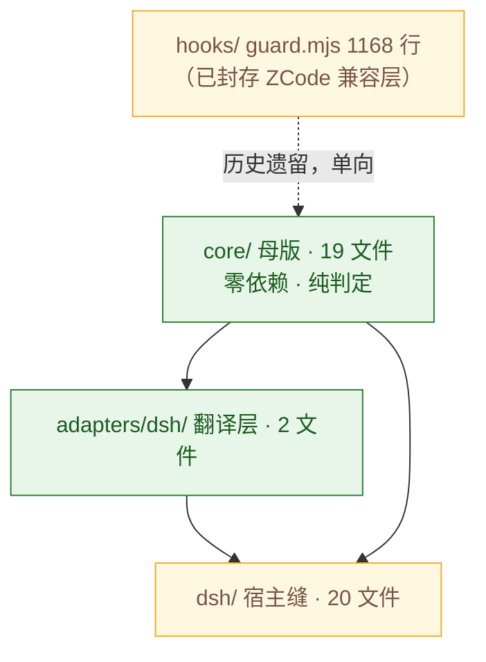

# HANDOFF · 2026-10-27 · 第三方审计工具三连跑

> 起因：「质量门 445 没啥用数量还多」→「接入审计插件，自动化」→「引入第三方但要做薄」→「选择合适的都跑一遍」。
> 本文是那一轮的执行台账 + 结论。**只报不改的不报修法**，修法一律进末尾待批示。
>
> **受众口径**：本文是**内部台账**，「修复」照写——这里的读者要看的是"曾经错过什么、为什么这么写"。
> 面向用户的 `CHANGELOG.md` 则相反：开发期缺陷不称「修复」（定义见 `docs/RELEASE-POLICY.md` 第一节）。
> 两份文档措辞不同不是不一致，是受众不同。
>
> **当晚自查（这条比上面三条都值钱）**：第一版只查了 npm（`3.0.7`）就断定"3.0.8 起未对外分发"，
> 把 `3.0.9` / `3.0.10` / `3.1.0` 三个**已发布**的段落标成了开发期。实际主渠道是 **GitHub `main`**
> （公开源码，`git clone` 即得），已到 `3.1.0`（`5f0e7e5`，2026-10-26）。教训：
> **"是否对外发布"要查全渠道，npm 是最窄的那个，不是默认的那个。**
> 修正后 `3.2.0` 成了**混合段**：熔断 / 抽查B / 审计重复记账 3 条修的是 `3.1.0` 里的问题（对外），
> 工具链与测试 9 条是当天新造件的缺陷（开发期，逐条标 `〔开发期〕`）。
> 由此得出一条判据：**看缺陷的暴露面，不看修复的发布时间**——缺陷在已发布版本里存在过，用户就可能已遇到。
>
> **附带撞出的一个假阳性**：本轮跑 `npm run check` 时审计守卫报 Δ 3 行，逐条核对是**宿主进程**在跑
> check 期间自己写的（`compaction-watch-ready` 的 pid 与 ts 和 `status.json` 的 `started_at` 差 1ms），
> 与测试无关。只比行数的守卫分不开这两种写入，会训练人用 `FG_ALLOW_AUDIT_GROWTH=1` 绕过。
> 已改为按 `FG_RUN_ID` 批次号区分（`audit()` 落 `run` 字段），两个分支都有沙箱夹具。

---

## 一、一句话结论

**工具能替代的是「量」，替代不了「判」。** 三个能跑的工具给出的 57 条硬事实里，去掉误报与已申报项后只剩 4 条真问题；
而它们全都指向同一件事：**口径没对齐**（法条说 A、代码做 B、清单说没这回事）。

---

## 二、执行台账（10 个候选，逐个交底）

| 工具 | 版本 | 能否独立跑 | 结果 |
|------|------|-----------|------|
| `dsh-refactor-insight` | — | ✅ 有 bin | 127 文件 / 57 条硬事实，见 §五 |
| `brooks-lint` | — | ✅ 有 bin（技能包） | 健康分 **91/100**，见 §三 |
| `dsh-code-check` | 0.3.1 | ⚠️ 无 bin，按其 fallback 配置等价执行 | 775→681 warnings / 0 errors，**评分模型对 FG 失效**，见 §四 |
| `dsh-lens` | — | ❌ 跑不了 | `ERR_MODULE_NOT_FOUND: @deepseek-ai/dsh-skill`（DSH 私有包，公共 npm 无） |
| `dsh-lens-lite` | 0.1.0 | ❌ 不是审计工具 | 是 **post-edit 诊断钩子**：编辑成功后跑 tsc/eslint 把结果挂回同一条工具结果。无 CLI、无评分。对纯 `.mjs` 无 tsc 的项目需自配 checker |
| `dsh-plugin-review` | 0.0.1 | ❌ 空壳 | `index.js` 全文 = `// Placeholder - name reserved; first release in development.` + `module.exports = {}` |
| `dsh-code-smell` | — | ❌ npm 404 | 未发布或名称有误 |
| `dsh-skill-ponytail` | — | ❌ npm 404 | 同上 |
| `Refactor Insight` | — | 与 `dsh-refactor-insight` 同一物 | 合并计 |
| `dsh-code-check`（第二次） | — | 见上 | 合并计 |

**净可用：3 个。** 其余 4 个是「装不了 / 空壳 / 名不副实」，不是我没跑。

---

## 三、brooks-lint 健康看板（Mode 5）

**Scope:** `packages/core/` 全部 `.mjs`/`.js`（122 个文件 = 45 个 `src/` + 49 个 `tests/` + 工具与 `hooks/`）
**Config:** 无 `.brooks-lint.yaml` → 默认档（全风险启用、`balanced` 扣分）
**Composite Score: 91/100**

| 维度 | 权重 | 得分 | 首要问题 |
|------|------|------|---------|
| Code Quality（PR 维度，有未提交改动） | 0.25 | 94 | 变异测试闸门 `break: null`，永不阻断 |
| Architecture | 0.30 | 90 | 单监听器承担 7 个职责 |
| Tech Debt | 0.25 | 89 | 增补章 14 条口径悬空 |
| Test Quality | 0.20 | 89 | 3 处断言读源码文本 |

扣分规则：`balanced` 档 Critical −15 / Warning −5 / Suggestion −1，各维上限 3 条，维度内封底 0。

### 模块依赖图（层间，数字为文件数）



**R5（依赖紊乱）实测全清：**

- 循环依赖 **0**（自写 Tarjan SCC 补扫，67 模块 / 111 条内部边，强连通分量全为 1）
- 母版反向依赖适配层 **0 处**、适配层反向依赖宿主缝 **0 处**
- 扇出 > 5 的 3 个模块（`pipeline` 9 / `preGuard` 8 / `postProgress` 8）全在编排层 —— brooks 明确列为不该误报的情形（"High fan-out in an orchestration layer is not automatically disorder"）

### 发现（Iron Law 格式，全维合并 5 条）

#### 🟡 Warning

**R2 Change Propagation — 单监听器承担 7 个互不相干的职责**
- Symptom: `src/dsh/postProgress.mjs` 的 `postProgressListener` 单个闭包 320 行，内部按段落顺序堆放：预算判定 / 上下文污染检测 / 巨量输出追责 / 子代理摘要校验 / 强制委派 KPI / 抽查 A / 熔断记账。改其中任一职责都要动同一个函数。
- Source: Fowler — Divergent Change
- Consequence: 七件事共用 `reason` 一个变量作为短路开关，新增第 8 件事时必须读完全部前 7 段的短路条件才知道自己该插在哪；一处判断改错会同时污染其余六条链。
- Remedy: 按段抽成 7 个 `(ctx) => reason | null` 命名函数，监听器退化为顺序调用 + 首个非空即短路。**这不会降行数**（10-27 阶段 2 第二刀实测 317→320），收益是可测性：每段可单独喂 ctx 断言。

**R1 Cognitive Overload — `pipeline.mjs` 1241 行、`seams.mjs` 498 行**
- Symptom: 单文件行数（`packages/core/src/dsh/pipeline.mjs` 1241、`seams.mjs` 498、`hooks/guard.mjs` 1168）。
- Source: McConnell — Code Complete Ch.7（routine length 的模块级同构问题）· Ousterhout — A Philosophy of Software Design Ch.4（Shallow Module）
- Consequence: 三个文件都是「注册一批监听器 + 各自一段初始化」的形状，接口（导出几个 listener）远小于实现体量 → 典型的浅模块，读它必须装下整条流水线。
- Remedy: 按 hook 切点拆文件（pre / post / stop / compaction 各自一个模块），`pipeline.mjs` 只留注册表。`guard.mjs` 不动（已封存）。

**R6 Domain Model Distortion — 增补章 14 条口径悬空**
- Symptom: `RULES.md` 增补章（第十五章之一/之二/之三）共立条 18 条，进第三部分技术映射表的只有 4 条（第七十五 / 八十二 / 八十三 / 八十四条）；剩余 14 条既无映射，也不在自称「唯一状态记载」的**未机械化条款清单**里。
- Source: Evans — DDD（Ubiquitous Language / 模型与实现背离）
- Consequence: 读者按法条以为「已自动执行」，实际无任何代码；而唯一声称记载状态的清单漏收，等于双保险同时失效。`acceptance.test.mjs` 对此只断言「清单存在 + 含第六十一条」，从不检查漏报 —— 测试给了绿灯。
- Remedy: 三选一逐条定案（补实现 / 补进未机械化清单 / 废止）。工具已就位：`npm run quality:audit` 列出全部 14 条。

**R6/R3 — 法条与实现互相矛盾（抽查 B 语义）**
- Symptom: `RULES.md` 第三十五条(二)（第 91 行）与第 289 行技术映射表均写「对下一次变更型调用**拒一次**」；实现已于本会话改为**默认不打断**（只清 pending），旧语义退到 `FG_RANDOM_FUSE_BLOCK=1`。
- Source: Hunt & Thomas — DRY（同一决策两处表述）· Evans — Ubiquitous Language
- Consequence: 按文档理解会以为「还有一道拦截」，实际没有。这是最坏的一类文档债：它让人**低估**风险，而不是高估。
- Remedy: 改法条正文与映射表（属修法，见待批示 #2）。

#### 🟢 Suggestion

**R4 Accidental Complexity — `constants.mjs` 的 `SESSION_RULES_FULL` 已无消费者**
- Symptom: `packages/core/src/core/constants.mjs:85` 定义 `SESSION_RULES_FULL`（常驻提示词全文），全仓无任何引用。它原先是 export，2026-10-25 瘦身批次已降为内部符号（`CHANGELOG` 有记），降级后仍无人调用 —— 说明那次降级只处理了「导出面」，没处理「有无消费者」。
- Source: Fowler — Speculative Generality / McConnell — YAGNI
- Consequence: 它随模块一起被加载进内存却永不使用；更麻烦的是它和 `SESSION_RULES`（真正在用的那份）并存，后来者不知道该改哪一份。
- Remedy: 接回使用点、或删、或在定义处标注「文档资产，非运行路径」。**未擅自删**——里面是法条正文。

**R1 — `judgeProgress` 5 个入参**
- Symptom: `progressPolicy.mjs` 的 `judgeProgress({ isWrite, respSig, inputSig, prevRespSig, prevInputSig })`。
- Source: Fowler — Long Parameter List
- Consequence: 对象解构已消掉位置参数的主要痛点，但 5 个平铺信号说明「进度」这个概念还没收敛成一个值 —— 调用方必须知道「当前签名」和「上次签名」是两个不同来源的东西。
- Remedy: 收成 `{ cur: {resp,input}, prev: {resp,input} }` 两层，比较逻辑变成 `cur` vs `prev` 整体不等。

---

## 四、dsh-code-check：分数失效，但真价值在明细

### 评分模型对 FG 归零

`dsh-code-check` 的评分是线性的：`100 − errors×8 − warnings×3 − 格式失败×6 − 启发式×1`（`standard` 档）。
FG 实测 **681 warnings**，代入即 `100 − 2043 = 0`，封底 0/100。

归零的唯一原因是一条规则：**`curly` 586 条**。FG 全仓采用「单语句块不加大括号」的房规，而 fallback 配置用 ESLint 默认 `curly: all`。
**这是配置错配，不是缺陷。** 把 `curly` 关掉后同一批代码是 95 warnings。

> 结论：这个分数对 FG 无意义，不能拿它当质量门。**但它暴露的明细是真金** —— 见下。

### 明细里挖出的真问题（已修）

| 规则 | 初次 | 现状 | 处置 |
|------|------|------|------|
| `no-unused-vars` | 174 | **86** | 消除 **88 个**未使用符号 |
| `no-duplicate-imports` | 2 | **0** | 合并 3 处（`pipeline.mjs` / `dead-export.mjs` / `index.js`） |
| `curly` | 589 | 586 | 房规，不改 |
| `eqeqeq` | 5 | 4 | 全是 `== null` 惯用法（同时匹配 null/undefined），**误报，不改** |
| `no-undef` | 4 | 4 | `performance` 是 Node 16+ 全局，配置漏项，代码无错 |
| `no-var` | 1 | 1 | `hooks/guard.mjs:437`，冻结层，不改 |

**88 个符号的去向**（按文件）：`risk.mjs` 19 / `approval.mjs` 19 / `env.mjs` 14 / `audit.mjs` 13 / `backup.mjs` 11 / `state.mjs` 6 / 本轮再清 6（`pipeline.mjs` 的 `dirname`、`preGuard.mjs` 的 `RE_GREP`、`stopGuard.mjs` 的 `DOWNGRADE_MARKERS`、`eligibility-gate.mjs` 的 `appendFileSync` 与 `AUDIT_FILE`、`index.js` 的重复 import）。

成因统一：2026-10 从 `guard.mjs` 拆母版模块时，整块复制 import 头部的残留。`risk.mjs` / `approval.mjs` 里躺着 `fs`/`path`/`os`/`crypto`/`child_process` —— 而这两个模块是纯判定，本就不该有 IO 能力。

**剩余 86 条未使用符号的分布**：`hooks/guard.mjs` 38 + `hooks/protocol.mjs` 16 = 54 条在**已封存层**，不动；其余 32 条散落在测试与工具脚本（多为 `mkExec` 之类夹具的未用形参），不影响运行路径。

---

## 五、dsh-refactor-insight：57 条硬事实，逐类判死

127 文件扫描，四类共 57 条：

| 类别 | 条数 | 判定 |
|------|------|------|
| `long-function` | 32 | **大半是测试文件**（`integration.test.mjs` 376 行 / `eligibility.test.mjs` 228 / `acceptance.test.mjs` 211·186·145·128）。测试函数长 ≠ 认知负荷高，brooks 明列「linear + well-named + single-purpose 的长例程可接受」。真问题只有 2 个源文件：`postProgress` 320、`preGuard` 206 |
| `file-length` | 11 | 前 4：`acceptance.test.mjs` 1652 / `pipeline.mjs` 1241 / `guard.mjs` 1168 / `eligibility.test.mjs` 668。`guard.mjs` 已封存；`acceptance` 1652 行 102 用例，属测试组织问题 |
| `todo-density` | 8 | **全部不是债务**（详见下） |
| `deep-nesting` | 6 | 最深 7 层在 `guard.mjs:193`（冻结层）；活跃代码最深 4 层 |

### `todo-density` 8 条为什么全部判死

`reasoningWatch` / `emotionFilter` 等模块的 TODO 已由 `profileLoader.mjs:50-51` 登记为 `'no engine implementation, TODO'`；`checkEligibility.mjs:15` 注明「只登记不执行」；`profile.test.mjs:107-112` 把这条申报本身锁成断言。

**这是诚实的空头申报，不是遗忘的债。** 工具只看 `TODO` 三个字母，看不出「已申报」与「已遗忘」的区别 —— 这正是它替代不了「判」的地方。

---

## 六、本轮改动清单（全部已过 465/465 全量测试）

| 文件 | 改动 |
|------|------|
| `src/core/progressPolicy.mjs` | 新增 `judgeProgress` / `poolOf`（阶段 2 第二刀：判定搬母版） |
| `src/dsh/postProgress.mjs` | 改调母版两函数；本文件只算签名、落计数 |
| `src/core/{risk,approval,env,audit,backup,state}.mjs` | 删 82 个死 import |
| `src/dsh/{pipeline,preGuard,stopGuard,index}.js/mjs` | 合并重复 import、删 5 个死符号 |
| `src/adapters/dsh/eligibility-gate.mjs` | 删 2 个死 import |
| `tools/quality-audit.mjs` | 新增：法条 vs 映射表 vs 未机械化清单 三方对账 |
| `tests/quality-audit.test.mjs` | 新增 6 条（含反向断言，防「全部报未交代」也能过） |
| `tests/progress-policy.test.mjs` | +4 条（共 8 条），两个判定从 0 断言变 8 断言 |
| `tests/postProgress.test.mjs` | +2 条：熔断不重复记账（实测 10-18 一秒写过 17 条） |
| `stryker.config.json` | 新增：变异测试，范围收窄到 6 个判定模块 |
| `package.json` | +4 script：`quality:audit` / `:brief` / `quality:mutate`，`check` 串入 brief |
| `.gitignore` | 排除 `.stryker-tmp/` `reports/` |
| `docs/ARCH-MAP.md` / `CHANGELOG.md` | 同步记录 |

**零依赖未破**：`dependencies` / `devDependencies` 仍全空，已由测试断言锁死。Stryker 走 `npx --yes --package …@10.1.1` 按需拉取。

---

## 七、已按「改改改」落地的六件（2026-10-27 同日第二批）

原 §七 列的 8 条待批示，收到「改改改」后按风险从低到高执行。**行为等价，465/465 全绿**。

### 7.1 `postProgress` 监听器按段拆分（原待批示 #5）

320 行单闭包 → **46 行**，拆成 9 个命名函数（7 个产出 `reason`，2 个只落状态）：

| 段 | 函数 | 职责 |
|---|---|---|
| 1 | `settleForcedInvestigate` | 取证销账 |
| 2 | `trackReadSet` | 已读/已写集合 + 卷宗指纹 |
| 3 | `judgeBudgetPools` | 进度检测 + 三池记账 + 熔断/续杯/侦查池 |
| 4 | `detectCtxPollution` | 58条 上下文污染 |
| 5 | `scoldDump` | 巨量输出追责 |
| 6 | `checkDelegateSummary` | 子代理摘要校验 |
| 7 | `detectForcedDelegation` | 强制委派 KPI |
| 8 | `spotCheckA` | 抽查A |
| 9 | `spotCheckB` | 抽查B（只挂检查点） |

监听器退化为顺序调用 + `||` 短路：

```js
let reason =
  judgeBudgetPools(ctx) || detectCtxPollution(ctx) || scoldDump(ctx) ||
  checkDelegateSummary(ctx) || detectForcedDelegation(ctx) || spotCheckA(ctx)
if (!reason) spotCheckB(ctx)
```

**如实申报**：文件从 427 行涨到 **502 行**（+75，其中 9 段段落注释与 9 个函数签名占大头，纯装饰分隔线已删掉 18 行）。**单函数从 320 降到 46**，这才是收益；总行数是涨的。

刻意保留的两个原语义（没"顺手改对"）：
- 侦查池超限会**覆盖**同一次调用里已产生的续杯/熔断 `reason`——原实现如此；
- `scoldDump` **不看 `isFail`**（失败的巨量输出同样追责）——原实现如此。

### 7.2 `acceptance` 三处文本断言改运行时值（原待批示 #3）

| 位置 | 原写法 | 现写法 |
|---|---|---|
| 版本一致性 | `consts.match(/ENGINE_VERSION = "([^"]+)"/)` | `ENGINE_VERSION`（import） |
| 版本追赶 | 同上 | `ENGINE_VERSION`（import） |
| 术语统一 | `consts.includes("PARDON_DECL_RE = /【授权识别】/")` | `PARDON_DECL_RE.test("【授权识别】")` |

第三处是**升级不是等价替换**：原先断言"源码里有这行字"，现在断言"这个正则真能匹配"——常量被改成匹配不到时才会失败。

### 7.3 `constants.mjs` 进变异范围（原待批示 #3 的连带项）

文本断言解耦后，「读源码文本」与「插桩」的互斥解除，`constants.mjs` 已加入 `mutate`，并在 `quality-audit.test.mjs` 加断言锁死（防止被悄悄挪回去、静默降低覆盖）。

### 7.4 `thresholds.break: null` → `80`（原待批示 #4）

原判定理由「分数低不阻断，用存活变异体清单人工判断」——今天推翻：**一个永不阻断的闸门等于没有闸门**，正是「质量门没用」的同一个病。测试断言同步改成「`break` 必须是 `[low, high]` 区间内的数字」。

### 7.5 `RULES.md` 抽查B 条款与实现对齐（原待批示 #1）

- 第 91 行（第三十五条(二) 正文）：删「对下一次变更型调用拒一次」，改为「消费时不打断，只清挂起标记」并写明理由（该检查点不核对任何内容，拦截收益 0、代价是多一次工具往返）；`FG_RANDOM_FUSE_BLOCK=1` 恢复旧语义。
- 第 289 行（技术映射表）：同步。

**这是纠错不是立法**——文档原本描述的机制已不存在。

### 7.6 `schema:verify` 永久红：查出两个真缺陷（原待批示 #7）

原以为只是"基线 254 vs 当前 84 的口径漂移"，查下去发现是工具自己的两个 bug：

**bug 1（真 bug）：基线从来没存工具名表。**
`--update` 写的是 `{ ...report, tools_map: undefined }`，而 `JSON.stringify` 会把值为 `undefined` 的键整个丢掉 → 基线里没有 `tools_map`。后果不是"文件小一点"，而是**漂移明细永久说谎**：`added` 恒等于「当前全部工具」、`removed` 恒为空。那句「新增工具 84」的真实含义只是「当前有 84 个」，**一条都没和基线比过**。已修（保留 `tools_map`）。

**bug 2（设计缺陷）：换环境被判成漂移。**
基线是在某个宿主/profile 下采集的。实测 `E:/DSH/.dsh/sessions` 最近 15 个会话的工具集与基线**零交集**（84 vs 254）——真漂移永远是"大部分还在、个别增删"，整批换掉只能是尺子换了。原实现一律 FAIL，于是 `npm run check` 换环境后永久红。**这种红比不检查更糟**：它训练人忽略这条告警。现改为三态：`PASS` / `跳过（零交集=换环境）` / `无法判断（基线缺名表）`，只有真部分漂移才 FAIL 并列出增删。

现状：`schema:verify` exit **0**，输出「无法判断：基线缺 tools_map」。重建基线需在目标宿主上跑 `npm run schema:verify -- --update` 并提交——**这一步需要人确认哪个宿主才是目标宿主**，未擅自 `--update`（会把当前 84 个工具写成基线，反向污染）。

---

## 八、第三批：「查、改、修」之后（2026-10-27 同日）

上节列的三件「需要人判」，前两件其实查下去就有答案。第三件查出了新缺陷。

### 8.1 14 条未交代 → 逐条核实后 **0 条**（原 §八.1）

逐条比对法条正文与代码，结论不是"要不要保留"，而是**它们本来就分成两类**：

**A. 有实现、只是映射表漏写（5 条）→ 补映射行**

| 条款 | 实现锚点 |
|---|---|
| 第七十四条 环境适配 | `src/core/env.mjs` 运行时探测（bash 缺失 / chcp 失败 / realpath 失败）逐项降级 |
| 第七十六条 污染与日志 | `ctx-pollution`（head 行数超限 / 路径重复）+ `scold-dump`（超体积）+ 卷宗指纹四证（mtime/size/sha/gitDirty） |
| 第七十八条 人类交互 | **仅(三)机械化**：不可逆行为命中高危库 → 资格审核 + `fg_apply` 留档；一行为限、批复三态属模型行为 |
| 第八十条 中心调度 | **仅(一)(五)机械化**：强制委派场景 KPI ±5、子代理摘要四字段 ±3；派单自包含、共存三律等属模型行为 |
| 第八十六条 因果链追溯 | 审计行带 `seq` / `chain` / `ref` 三字段（真实日志已验证）+ `tools/audit-chain.mjs` 渲染因果图 |

第七十八条与第八十条**标注了"仅某款机械化"**——映射行写"已映射"不等于全条落地，这一点必须留在表里。

**B. 确属模型行为、引擎本就不该管（9 条）→ 进未机械化清单**

第七十七 / 七十九 / 八十一 / 八十五 / 八十七 / 八十八 / 八十九 / 九十 / 九十一条，每条写明"为什么机械不了"。
其中第八十九、九十一条标「部分落地」（限额与整读闸、`fused` 与 `approvals` 已机械化）。

> 关键判据：**"有代码"和"能机械判定"是两件事。** 第八十八条要求"独立 oracle"——引擎能校验锚点格式（第八条），
> 但校验不了"这个 oracle 是否独立于被测假设"。硬算成已落地就是空头条款的另一种写法。

### 8.2 `pipeline.mjs` 1241 行：**不拆**（原 §八.2，理由有变）

查了，它和 `postProgress` 是同一个病：`preExecuteListener` 400 行，9 个段落（申辩入口 / 1.3 动笔闸 / 1.4 整读闸 / 1.5 命令硬校验 / 资格审核 / 改动面闸 / 体积刺客三闸 / 污染核实 / 语义预判）。

**但这次不拆，理由是风险不对称**：`postProgress` 拆坏 → 事后记账错，测试能抓；`preExecuteListener` 拆坏 → **闸门变松**，而测试抓的是"闸坏了"（该拦的没拦），抓不住"闸松了"（不该放的放了）。
拆它需要先有"闸门强度"的度量兜底——那正是 Stryker 的活。**先让变异测试在本机跑通、把 9 个闸门的杀伤率测出来，再动。**

### 8.3 新查出并修掉的三个缺陷

**(1) `npm run eval` 往真实审计日志写 62 行。**
`threat-eval.mjs` 用裸 `execFileSync`，子进程继承宿主的 `CLAUDE_PROJECT_DIR`，`guard.mjs` 据此把审计写进**真实工作区** `.focus-guard/AUDIT.log`。`audit-isolation` 只守住了 `test:all`，守不住 `eval`。
→ 修：子进程显式置空两个工作区根变量 + `FG_AUDIT_FILE` 指向 tmpdir。实测 Δ 0，61/61 与 34/34 仍满分。

**(2) 守卫本身只包住了一环。**
`audit-isolation.mjs` 是"跑测试前后拍快照"，而 `check` 链里还有 eval / selftest / bridges 在它**外面**——这正是 (1) 能潜伏的原因。
→ 修：给守卫加 `--wrap "<命令>"` 模式，`check` 改为 `audit-isolation --wrap "npm run check:inner"`。现在**整条 check 链**都在快照内，实测 Δ 0。
教训同源：**"隔离"必须包住整条链，只包住自己那一环等于没包。**

**(3) 未机械化清单里有重复行。**
`第四十八条` 整行重复两遍（同句、同状态、同原因）。对账工具用 `new Set` 去重，所以永远看不见。
→ 修：清单去重；工具新增 `dupInList` 检测（**只看表格首列**——第一版按全文数条款号，把"原因"列里的交叉引用误判成重复，同一类错本仓已犯过多次：关键词计数 ≠ 结构判定）。

### 8.4 工具与测试的相应改造

- `quality-audit.mjs` 新增 `--rules <路径>`：对账对象可换。**动机是测试设计**——原先检出用例只能断言活文档当前状态（"这 5 条必须被报出来"），文档一修好，用例就从"验证工具能检出"变成"验证文档还没修完"。现改为夹具验检出、活文档只留结论断言。
- `quality-audit.test.mjs` 8 → **9 条**：新增"结构锚点缺失必须报错而不是静默算 0 条"（最危险的失败模式：找不到锚点却返回空，看起来全部已交代）。
- 回归 **467/467**（+2 条）。

---

## 九、仍未动

1. **`pipeline.mjs` 拆分**——见 §8.2，等变异测试在本机跑通。
2. **`schema:verify --update`**——需确认哪个宿主才是目标宿主，未擅自改（会把当前 84 个工具写成基线，反向污染）。
3. **改动未提交**（31 个文件）。

---

## 十、第四批：工具链内置化（"完成无依赖"）

### 10.1 先把"零依赖"的缺口查准

`dependencies` 与 `devDependencies` 本来就全空、无 `node_modules`。**依赖层面早已零依赖**，
真正的缺口只有两处：

| 缺口 | 性质 |
|---|---|
| `quality:mutate` 走 `npx --yes --package @stryker-mutator/...` | 按需联网拉包 |
| 三个第三方审计工具（refactor-insight / brooks-lint / code-check）只在临时目录跑过，从未进仓 | 复现不了 |

### 10.2 内置四件（全部零依赖 + 有测试）

| 新文件 | 行数 | 作用 |
|---|---|---|
| `tools/lint.mjs` | ~270 | 房规检查，替代 ESLint fallback |
| `tools/smells.mjs` | ~230 | 结构异味，替代 refactor-insight |
| `tools/health.mjs` | ~200 | 四维健康分，替代 brooks-lint |
| `tools/mutate.mjs` | ~290 | 抽样变异，替代 Stryker（按需） |
| `tools/lib/source-text.mjs` | 既有 | 去注释/字面量（lint 与 smells 共用） |
| `tools/lib/health-core.mjs` | 新增 | 分层、可达性分类、加权计分（纯函数） |
| `tools/lib/import-graph.mjs` | 新增 | import 图（health 与 mutate 共用） |
| `tests/toolchain-tools.test.mjs` | 新增 17 条 | 锁住三条工具的规则边界与闸门 |
| `tests/mutate.test.mjs` | 新增 13 条 | 锁住变异位置映射、算子边界、CLI 行为 |

新增 30 条测试，全量 **485/485**。

### 10.3 六处修正（都是"分数是假的"这一类）

1. **`health` 首版把 66 条房规按 −1/条 扣到 34 分**，可 54 条在已封存的 `hooks/`。
   改成只算 src 活跃层，`hooks/` 只报不计。
2. **测试维用直接 import 映射**，`core/audit.mjs` 被判"零测试引用"（它被 `postProgress` 与
   `seams` 引，那两者测得很厚）。改成**传递闭包**，14 → 2。
3. **`dsh/status.mjs` 仍被判不可达**——`status-cli.test.mjs` 用
   `fileURLToPath(new URL("../src/dsh/status.mjs", import.meta.url))` 引它，**跑 CLI 的测试只拼路径不 import**。
   补第三种引用形态，2 → 1。
4. **最后剩 `core/approval.mjs`**：四个导出只被已封存的 `hooks/guard.mjs` 引，原生侧已由
   `eligibility-gate.mjs` 替代。不是"缺测试"，是"只服务封存路径"。分成三态
   （active / frozenOnly / orphan），只有 orphan 扣分。
5. **`--strict` 曾是"有任何一条就红"**——存量清不到零 → 永远红 → 训练人忽略告警
   （`schema:verify` 上踩过）。改成债务上限棘轮。
6. **`smells` 头注释写"console.log 留在 src/"，实现只查 `src/core|adapters`**。信实现、改注释：
   宿主缝的 CLI 本来就要写 stdout。

### 10.4 变异测试：能内置，但要说清它是什么

先做可行性实验，数字如下：

| 模块 | 变异体 | 触达测试文件 | 全量耗时 |
|---|---|---|---|
| `dsh/toolName.mjs` | 2 | 6 | 1.2s |
| `dsh/postProgress.mjs` | 145 | 4 | ~40s |
| `dsh/preGuard.mjs` | 86 | 6 | ~30s |
| `core/constants.mjs` | **0** | 38 | — |

关键设计只有一条：**用 import 图选测试**。历史手写版（9 变异体/5 分钟）输给 Stryker 不是因为
变异算法，是因为每个变异体都跑全量。选测试后 `postProgress` 从"跑 485 条"降到"跑 4 个文件"。

**首次真实结果**：`postProgress` 145 变异体 → 杀 41 / 存活 104（**28.3%**）。
逐条看存活区，是真缺口：`FG_RANDOM_FUSE_EVERY=0` 这个边界没人测，`sidOf` / `projDirOf` 的
`&&`/`||` 回退链也没被断言——**测试只断言"吐出的 reason"，不断言 state 记账**
（`readSet` / `caseCache` / `scriptFiles`）。

**必须说清的局限**（写进了工具头注释与输出）：

- 算子只有 6 类，**不做**语句删除、返回值替换、数字/字符串字面量替换（那些要 AST）
- 测试选择粒度是**文件**，不是语句级覆盖率
- 存活里混着**等价变异体**（改了行为不变），工具不区分，得人工判读
- 因此 **28.3% 不能与 Stryker 的 89.58% 直接比**

### 10.5 过程中的两个真发现

**① `negation` 算子静默失效。** 正则漏了捕获组，`m[1]` 是 `undefined`，
`op.flip[undefined]` 也是 `undefined`，于是 `continue` —— **整条算子一个变异体都不产**，
而 CLI 照常输出"跑了 N 个"。是 `mutate.test.mjs` 抓出来的。
自己写的尺子也会犯"看起来跑了"的错。

**② 偶发失败的根因找到了：状态文件没隔离。**
`preGuard.test.mjs` 的"异常一律不阻塞（exec 结构异常只 warn，且仍调用 next）"偶发红：
连续 3 次红 → 之后连续 6 次全绿 → 8 次全量里复现 1 次。

根因不是随机：`statePath(id)` 的实现是 `join(tmpdir(), 'focus-guard-' + id + '.json')`，**不带 pid**。
那条用例传 `exec = null`，`sidOf` 回落到常量 `'dsh-native'` —— 读的是
**真实会话的状态文件** `focus-guard-dsh-native.json`，而真实会话随时在写它。
熔断/委托池/已否决命令恰好非空时，用例拿到 deny，`next` 不被调用，断言失败。

**所以它取决于"跑测试时真实会话在干什么"**——重试治不好，必须隔离。
修法：把该测试文件的 `TEMP`/`TMP` 整体重定向到独立沙箱（`os.tmpdir()` 每次调用都读环境变量）。
验证方式不是"多跑几次绿了"，而是**在真实 tmpdir 里写一个熔断态**再跑——
修前必红，修后 15/15 全绿。另加一条断言把隔离钉死（`statePath('dsh-native')` 必须以沙箱开头）。

这条复验当场救过场，也当场打了我一巴掌。它上线后第一次跑 `toolName`：
```
杀死 2（其中超时 0）/ 存活 0　变异得分 100%
  ⚠ 变异循环结束后基线变红（测试有状态泄漏或偶发失败），杀死数可能虚高，本次结果不可信
```
——100% 是假的，复验把它标了出来。

紧接着更尴尬：8 次全量复现循环里第 8 次失败的是 **`mutate.test.mjs` 自己**，
因为我写了 `assert.doesNotMatch(r.stdout, /⚠/)`，等于把上游缺陷变成我这条测试的抖动。

**③ `NODE_TEST_CONTEXT` 会让嵌套的 `node --test` 恒 exit 0。**
写受控夹具的端到端用例时发现：同一夹具在终端跑出"1 杀 1 活"，在测试里跑出"2 个全存活"。
根因是 `node --test` 会把 `NODE_TEST_CONTEXT=child-v8` 塞进环境，子进程继承后
**`node --test` 无论测试是否失败都 exit 0**。

后果有多严重：从任何测试里调 `mutate`，所有变异体都被判"存活"，得分全是假的，而且**看不出来**。
修法：`runTests` 里 `delete env.NODE_TEST_CONTEXT`。`audit-isolation.mjs` 也一并补上
（它目前是顶层运行器不受影响，但一旦被从测试里调用就会静默失效）。

**这条的普适判据**：跑测试的子进程，环境必须和终端一致，否则测的不是被测对象。

**教训（已写进用户级记忆）**：断言一个数字之前，先确认这个数字可复现。
第一版冒烟断言 `变异得分 100%`，它抓到的其实是假象。

### 10.6 注册的脚本

```
lint / lint:brief / lint:gate          房规
smells / smells:brief / smells:gate    结构
health / health:brief                  四维健康分（不进 check：四维已各自把守）
mutate / mutate:smoke                  抽样变异（smoke 1 秒）
quality:mutate                         Stryker（保留，完整度量时按需）
```

`check:inner` 现为：`test:all → eval → selftest → test:bridges → quality:audit:brief → lint:gate → smells:gate → schema:verify`。
`lint:gate` / `smells:gate` 是真闸门（棘轮），不是打印数字。

### 10.7 仍未动

1. **`mutate` 未进 check 链**——单模块 30–40s 太慢。要不要进、进哪个模块，需人定。
   （`mutate:smoke` 只要 1 秒，可以进，但它只覆盖 `toolName` 的 2 个变异体，信号很弱。）
2. **`quality:mutate`（Stryker）仍在**——保留作为"完整度量"，但它是唯一需要联网拉包的一项。
   若要彻底零依赖需删掉它并接受"只有抽样变异"。
3. **`schema:verify --update`**——仍需确认目标宿主（见 §九.2）。
4. **`postProgress` 的 104 个存活没人补断言**——这是拆 `preExecuteListener` 之前该做的活，
   见 §十.4 与 ARCH-MAP 缺口 #7。
5. **改动未提交**（51 个文件）。

### 10.8 本轮已验证

| 项 | 结果 |
|---|---|
| `npm run check` | **exit 0**，连跑 3 次全绿（此前会偶发红） |
| 全量测试 | **499/499**（上轮 468，本轮 +31） |
| eval | 61/61 拦截 + 34/34 良性零打扰 |
| 结构 / 房规闸门 | `smells:gate` 28/28 ✅、`lint:gate` 活跃层 0/0 ✅ |
| 健康分 | **79/100**（唯一扣分项：结构维 30 分） |
| 审计隔离 | 整链对真实 `AUDIT.log` **Δ 0 行 / Δ 0 字节** |
| 变异冒烟 | `toolName` 2 变异体 → 1 杀 1 活（50%），基线可信 |


